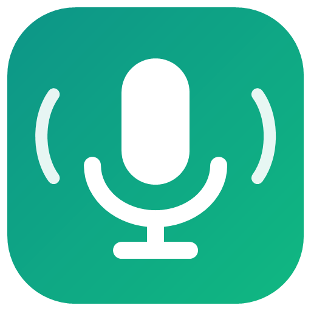

<p align="center"></p>

<h1 align="center">Voice Dictation for Windows</h1>

<p align="center"><b>Hold Ctrl+Win, speak, release. Your words are typed into any app.</b><br>
Free push-to-talk dictation that runs completely on your PC: no account, no cloud, no subscription.</p>

---

## What it does

- **Dictate into any app.** Chat apps, browsers, Word, VS Code, email, terminals: wherever your cursor is.
- **See your words as you speak.** A small pill at the bottom of the screen shows the live transcript.
- **Clean text.** filler words are removed ("um", "uh", "basically", "you know", Hinglish "thik hai na?", "Haan to like …", repeated phrases, stray "Ok."); say "comma", "full stop", "question mark", "new line" for punctuation;
  "…scratch that…" drops the phrase before it; a personal dictionary fixes words it gets wrong.
- **Hindi + English.** Press Alt+Shift+H to dictate Hinglish (Hindi is typed in Roman letters). Press again for English.
  For fewer mistakes, tray › *Dictation language* › *Hindi + English — accurate* uses a larger model (a few seconds per
  phrase, one-time 830 MB download); words still show live while you speak.
- **Private by design.** The microphone is on only while you hold the keys. Speech is turned into text on this PC by
  [Whisper](https://github.com/openai/whisper); audio and text are never uploaded or saved.

Want to *control* your PC by voice too ("Hey Jarvis, open Chrome", "click Library")? That's the sister project,
[Voice Assistant](https://github.com/shivam098/windows-voice-assistant). Voice Dictation is just the dictation part,
small and focused.

## Keys

| Keys | What happens |
|---|---|
| **Hold Ctrl+Win** | Records while held; release to type the text where your cursor is |
| **Ctrl+Win+Space** | Hands-free: keeps recording until you press it again |
| **Esc** (while recording) | Cancel; nothing is typed |
| **Alt+Shift+Z** | Paste the last dictation again |
| **Alt+Shift+H** | Switch between English and Hindi + English |

## Install

**Easiest (no install):** download the zip for your PC from the
[latest release](https://github.com/shivam098/windows-dictation/releases/latest), unzip it, and double-click
`VoiceDictation.exe`.

| Your PC | Download |
|---|---|
| Intel or AMD (most laptops and desktops) | `VoiceDictation-<version>-win-x64.zip` |
| ARM: Snapdragon, Surface Pro X, Copilot+ PCs | `VoiceDictation-<version>-win-arm64.zip` |

Not sure? Settings › System › About › *System type* says "x64-based" or "ARM-based".

- Windows may show **"Windows protected your PC"** because the app isn't code-signed: click **More info › Run anyway**.
- The first run downloads the speech model (about 265 MB, one time, SHA-256 verified). If
  [Voice Assistant](https://github.com/shivam098/windows-voice-assistant) is already installed, its models are reused.
- If Windows asks, allow microphone access (Settings › Privacy & security › Microphone › *Let desktop apps access your
  microphone*).

**From source** (installs the .NET 10 SDK for your user if needed, no admin):

```powershell
git clone https://github.com/shivam098/windows-dictation
cd windows-dictation
.\scripts\install.ps1 -StartAtSignIn
```

Remove it with `.\scripts\uninstall.ps1` (add `-RemoveData` to delete models and settings too).

> Don't run Voice Dictation and Voice Assistant at the same time: both use Ctrl+Win, so text would be typed twice.
> Voice Dictation warns you if it sees Voice Assistant running.

## Settings

Tray icon › **Open settings file** (`%APPDATA%\VoiceDictation\settings.json`), then restart the app.

| Setting | Default | What it does |
|---|---|---|
| `replacements` | `{"git hub": "GitHub", …}` | Personal dictionary: whole-word fixes |
| `snippets` | `{}` | Say the trigger to type the text, e.g. `{"my signature": "Thanks,\nShivam"}` |
| `newLineKeys` | Notepad, Word, VS Code: `Enter` | Keys for "new line" per app; others use Shift+Enter (a line break, not "send", in chat apps) |
| `livePreview` | `true` | Show words while you speak (uses extra CPU while recording) |
| `insertMethod` | `Paste` | `Paste` via the clipboard (restored afterwards, kept out of Clipboard History) or `Type` keystrokes |
| `removeFillerWords` / `spokenPunctuation` | `true` | Text clean-up |
| `soundFeedback` | `true` | Short tones when recording starts and stops |
| `microphoneDevice` | `-1` | Recording device index; -1 = Windows default |
| `modelFile` | `ggml-small.en-q8_0.bin` | `ggml-base.en-q8_0.bin` is faster but less accurate |
| `hinglishAccurateModelFile` | `ggml-hinglish-apex-q8_0.bin` | Model for *Hindi + English — accurate* (downloaded when first chosen) |
| `pasteLastHotkey` / `dictationLanguageHotkey` | `Alt+Shift+Z` / `Alt+Shift+H` | Hotkeys |

The tray menu also has: pause dictation keys, dictation language, always show the status pill, start when I sign in,
and open the logs folder. Logs contain timings and errors only, never what you said.

## Privacy and safety

- The microphone opens when you press Ctrl+Win (or Ctrl+Win+Space) and closes when you release (or finish).
- Recognition runs on your CPU with whisper.cpp. Nothing is sent over the network except the one-time model download.
- Audio and transcripts stay in memory only. The last dictation is kept in memory for Alt+Shift+Z until you exit.
- Password fields and windows running as administrator are never typed into.
- Clipboard pastes are excluded from Clipboard History and cloud clipboard, and your previous clipboard is restored.

## How it works

```
Ctrl+Win held ─► microphone (16 kHz) ─► live preview: Whisper every 0.6 s ─► pill
Ctrl+Win released ─► Silero VAD splits speech ─► Whisper small.en (or Hinglish Swift) ─► formatter ─► paste at cursor
```

| Folder | Contents |
|---|---|
| `src/VoiceDictation.Core` | Platform-neutral logic: formatter, live preview, chunking, inserter (unit-tested) |
| `src/VoiceDictation.Speech` | Whisper.net + Silero VAD wrappers |
| `src/VoiceDictation.App` | Windows app: key hook, microphone, tray, status pill, clipboard paste |
| `tests/VoiceDictation.Core.Tests` | Unit tests (`dotnet test`) |
| `tests/DictationLab` | Real-app acceptance test in a Chrome test page (`run.ps1`) |

The behaviour follows the dictation spec shared with Voice Assistant:
[docs/specs/dictation.md](https://github.com/shivam098/windows-voice-assistant/blob/main/docs/specs/dictation.md) and
[safety-and-privacy.md](https://github.com/shivam098/windows-voice-assistant/blob/main/docs/specs/safety-and-privacy.md).
See [docs/GUIDE.md](docs/GUIDE.md) for tips and troubleshooting.

## Build

```powershell
dotnet test tests\VoiceDictation.Core.Tests
dotnet build src\VoiceDictation.App -c Release -r win-x64     # or win-arm64
.\scripts\package.ps1                                         # portable zips in dist\
```

Releases are built by GitHub Actions when a `v*` tag is pushed (`.github/workflows/release.yml`).

## Credits

Speech recognition by [whisper.cpp](https://github.com/ggml-org/whisper.cpp) through
[Whisper.net](https://github.com/sandrohanea/whisper.net); voice activity detection by
[Silero VAD](https://github.com/snakers4/silero-vad); Hindi + English models by
Oriserve ([Swift](https://huggingface.co/Oriserve/Whisper-Hindi2Hinglish-Swift), [Apex](https://huggingface.co/Oriserve/Whisper-Hindi2Hinglish-Apex)). See
[THIRD-PARTY-NOTICES](docs/THIRD-PARTY-NOTICES.md).
